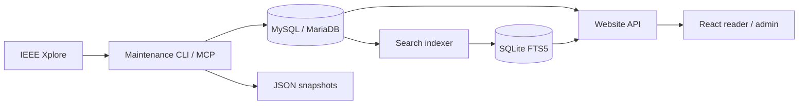

# CIRDC-Pro

[English](README.md) | [简体中文](README_CN.md)

CIRDC-Pro combines an IEEE research metadata collection engine with a searchable
research website. It maintains journal and conference catalogs, article records,
abstracts and keyword groups, then makes them available through a reader interface
and a separate administration interface.

The maintenance backend, website API and frontend are developed in **one Git
repository**, with separate Python environments for the maintenance and website packages.

## Features

| Area | Capabilities |
| --- | --- |
| Metadata backend | Catalog discovery, bibliographic updates, missing abstracts and keyword enrichment, Early Access rechecks, resumable jobs and atomic JSON publication |
| Reader website | Search titles, authors, keywords and abstracts; look up DOI/article numbers; filter by year, publication and venue family; browse ordered author identities |
| Research workflow | Paper details, BibTeX/IEEE/GB/T 7714 citation export, selection across loaded results and batch citations |
| Administration | Account management, task controls and logs, search-index status, preflight checks and optional resource-provider settings |
| Reading experience | Chinese/English UI, appearance themes, responsive layouts and mathematical title rendering |
| Optional resources | Explicitly configured providers can add cached document reading, local document links and batch archives; source and storage access depend on the installed provider |

Author profiles are optional and acquired only through an explicit single-author
operation. Browsing author identities does not fetch profiles. Document resources
are separate from the public metadata engine.

## Architecture and source tree



MySQL/MariaDB holds metadata and durable jobs. JSON retains the compatible
`publicationInfo/` and `articleInfo/` layout. The website maintains a recoverable
SQLite search projection; article details read the metadata database directly.
Search-index progress and metadata-maintenance progress are reported separately.

| Location | Responsibility |
| --- | --- |
| [src/cirdc/](src/cirdc/) | Maintained Python metadata engine, CLI and stdio MCP |
| [website/src/cirdc/web/](website/src/cirdc/web/) | Starlette/Uvicorn API, authentication, accounts and search indexing |
| [website/web/](website/web/) | React + TypeScript + Vite frontend, with KaTeX rendering |
| [database/](database/) | Empty schema and database contract |
| [tools/](tools/) | Maintenance setup/CLI and unified website development commands |
| [tests/](tests/) / [website/tests/](website/tests/) | Maintenance and website Python tests |
| [website/web/tests/](website/web/tests/) | Frontend behavior tests |

Both Python distributions are named `cirdc-pro` and import `cirdc`. Install them
in **different environments**: maintenance uses `.venv`; website development uses
`website/.venv-dev`. The website package retains compatibility modules for its
existing administration workflows. Long-lived collection uses the root engine.

## Get the source

On macOS or Linux, use Git and, for SSH storage, OpenSSH:

```sh
git clone https://github.com/NicolasV15/CIRDC-Pro.git
cd CIRDC-Pro
```

The public repository contains source and documentation. Configure datasets
separately; historical collection snapshots are not part of the public source tree. Maintenance setup uses Python 3.12 and can bootstrap uv. Website development
requires `uv`, Node.js 22.12+ and npm; its Python environment also uses Python 3.12.
Provide a MySQL/MariaDB target when working with metadata or building the search index.

## Metadata backend

### Install and select a target

Run from the repository root:

```sh
sh tools/setup.sh
sh tools/cirdc --help
```

Setup creates a regular installed package in `.venv`. Run it again after pulling
or changing backend code. Fixed collection runtimes remain separate from development;
preserve an active worker's environment, task identity and checkpoints.

For an existing local database/application account:

```sh
sh tools/cirdc config-init --output ~/.config/cirdc/targets/local.json
sh tools/cirdc --config ~/.config/cirdc/targets/local.json db-check --json
sh tools/cirdc --config ~/.config/cirdc/targets/local.json target-select --project "$PWD" --json
```

For an existing shared collection over your own SSH alias:

```sh
sh tools/cirdc target-init --ssh YOUR_SSH_ALIAS \
  --remote-config '~/.config/cirdc/config.json' \
  --output ~/.config/cirdc/targets/shared.json --workers 4 --json
sh tools/cirdc --config ~/.config/cirdc/targets/shared.json db-check --json
sh tools/cirdc --config ~/.config/cirdc/targets/shared.json target-select --project "$PWD" --json
```

`target-init` imports a private profile without overwriting an existing file.
`target-select` saves only its path in the ignored `.cirdc/active-target` pointer,
used by the root CLI and project MCP. `--config` or `CIRDC_CONFIG` overrides it.
Use [config.example.json](config.example.json) and
[config.ssh.example.json](config.ssh.example.json) as templates outside Git.

IEEE HTTP requests run on the computer starting the worker. SSH supplies database
forwarding and remote JSON storage; it does not move crawling or change network routing.

### Empty database and strict recognition

[database/schema.sql](database/schema.sql) contains ten empty tables.
An administrator can provision a new isolated local database and application account:

```sh
.venv/bin/python tools/bootstrap_mysql.py \
  --output ~/.config/cirdc/targets/new-local.json \
  --data-root "$HOME/.local/share/cirdc/collection"
```

Alternatively, provision an empty database yourself, configure its private profile,
and initialize it explicitly:

```sh
sh tools/cirdc --config /path/to/private/profile.json db-check --json
sh tools/cirdc --config /path/to/private/profile.json db-init --json
```

Validation covers columns, defaults, indexes, InnoDB/utf8mb4, migrations, application
identity and the pinned database UUID. Compatible targets can be used directly.
Recognized legacy version 2/3 targets require explicit `db-init --adopt`; incompatible
or foreign targets are rejected. Ordinary updates do not repair arbitrary tables.
See the [table guide](database/README.md) and
[schema contract](src/cirdc/schema_contract.json).

### Maintain and recover

After selecting and validating the target:

```sh
sh tools/cirdc doctor --json
sh tools/cirdc plan --publication PUBLICATION_ID --year YEAR --stage enrich --json
sh tools/cirdc update --publication PUBLICATION_ID --year YEAR --stage enrich \
  --skip-import --skip-catalog --workers 4 --json
sh tools/cirdc status RUN_ID --json
sh tools/cirdc resume RUN_ID --workers 4 --json
sh tools/cirdc retry RUN_ID --workers 4 --json
sh tools/cirdc paper ARTICLE_NUMBER --json
```

Replace uppercase placeholders with the intended identifiers/year. Omit
`--skip-import` when existing JSON still needs importing.

| Stage | Work |
| --- | --- |
| `catalog` | Discover journals/conference series and merge publication catalogs |
| `metadata` | Update basic article fields and recheck scoped Early Access records |
| `enrich` | Read article pages for missing abstracts and classified keyword groups |
| `all` | Combine the maintenance stages |

For a new empty collection, establish its catalog first with
`sh tools/cirdc update --stage catalog --json`; follow that job before requesting
publication-specific work. Default scope covers all indexed journals and conference
series. `--publication`, `--year` and `--max-tasks` limit a run; `plan` previews it
without starting a worker.

Updates return a durable run ID and continue in a local background worker.
Each HTTP thread has its own session, with an aggregate request-start interval
of at least one second. A coordinator handles database writes and atomic JSON
publication; locks, checkpoints and export acknowledgements support recovery.

Article numbers are stable identities; author order and keyword groups are preserved.
Confirmed source absence, future-year deferrals, pending work, blocked access and
failures remain distinct. Incomplete pagination or access challenges never count
as empty success. See [field sources and stages](docs/METADATA_STAGES.md) and
[maintenance lifecycle](docs/MAINTENANCE_LIFECYCLE.md). Explicit relationship analysis
is available through `sh tools/cirdc analyze` and is outside ordinary maintenance.

## Website frontend and API

The reader combines metadata search, publication/year filters, exact author
identities and paper details. Citations can be copied or downloaded individually
or for selected results. Configured resource providers can add document navigation
and local-file access. Reader and administrator applications have separate routes
and sessions; administrator serving is restricted to loopback.

Build from the repository root:

```sh
sh tools/web setup
sh tools/web build
uv pip install --python website/.venv-dev/bin/python \
  --reinstall-package cirdc-pro --no-deps ./website
```

The final command refreshes the regular development install with the built frontend assets.

Create a private website profile from
[website/config.example.json](website/config.example.json), with a reachable
MySQL endpoint and filesystem paths available to the website host. The website
uses its own configuration loader; the root CLI's automatic SSH target selection
does not configure the website connection.

For an already initialized website state, start a local development reader:

```sh
export CIRDC_CONFIG=/path/to/private/website.json
export CIRDC_WEB_STATE="$HOME/.local/state/cirdc-web-dev"
sh tools/web serve --interface reader --host 127.0.0.1 --port 18090
```

Open [the local reader](http://127.0.0.1:18090/). A fresh state directory also needs
account initialization and a search-index build. The indexer runs separately and
keeps search synchronized with metadata changes. Account setup, indexing, administrator
startup, access modes and deployment are covered in the
[website guide](website/README.md). The root package build contains the maintenance
engine; `sh tools/web build` creates the website wheel, source archive and frontend assets.

## Development and verification

| Component | Test | Build |
| --- | --- | --- |
| Maintenance | `.venv/bin/python -m pytest` | `.venv/bin/python -m build` |
| Website API and frontend | `sh tools/web test` | `sh tools/web build` |

Run database integration checks against a verified isolated test context:

```sh
CIRDC_INTEGRATION=1 CIRDC_CONFIG=/path/to/private/test-profile.json \
  .venv/bin/python -m pytest
(cd website && CIRDC_INTEGRATION=1 CIRDC_CONFIG=/path/to/private/website-test-profile.json \
  .venv-dev/bin/python -m pytest)
.venv/bin/python tools/check_release.py --component all --private-profile /path/to/private/profile.json
```

Keep the two Python test runs in their respective package directories. Integration
fixtures use connection-local temporary tables and isolated locks/paths. Release
checks inspect the maintenance source and distributions for deployment leaks and
schema-template consistency; inspect website distributions separately.

## Agents and further documentation

The root CLI and project stdio MCP use the same maintenance engine and selected
private target. Agent instructions live in [AGENTS.md](AGENTS.md) and the
[cirdc-maintenance Skill](.agents/skills/cirdc-maintenance/SKILL.md).
[CLAUDE.md](CLAUDE.md) delegates to the same workflow. Project MCP configuration
is provided in `.mcp.json` and `.codex/config.toml`; `tools/codex.sh` and
`tools/claude.sh` launch clients in the project context.

| Guide | Contents |
| --- | --- |
| [Development and runtime workflow](docs/LOCAL_REMOTE_WORKFLOW.md) | Separate environments, fixed runtimes, storage and deployment boundaries |
| [Maintenance lifecycle](docs/MAINTENANCE_LIFECYCLE.md) | Long-lived maintenance and historical repair boundaries |
| [Metadata stages](docs/METADATA_STAGES.md) | Field sources and Early Access behavior |
| [Website](website/README.md) | Frontend/API setup, indexing, accounts and builds |
| [Website behavior and deployment](website/docs/web.md) | Search consistency, access control, resource integration and release/rollback |
| [Author profiles](website/docs/authors.md) | Explicit single-author operations and portable records |

Credentials, deployment addresses, account state, indexes and checkpoints stay
outside Git. Machine-specific runtime locations belong in private configuration.

## Public source and private deployments

Published source and both package distributions use generic configuration examples.
Keep real hosts, addresses, SSH aliases, dataset paths, bootstrap account lists and
secrets in server-side private profiles. Ignored machine-context pointers locate the
existing configuration; publishing source does not replace it or restart services.

Before publication, build both packages and check them together:
`python tools/check_release.py --component all --private-profile /path/to/private/profile.json --private-values-file /path/to/private/release-values.json`.
The private values file is a JSON list, or an object with a `values` list. It can
include deployment-specific names and aliases without adding them to this repository.

## Attribution

This project continues Comprehensive IEEE Research Data Collections (CIRDC).
Retain the [CC BY 4.0 license](LICENSE) and upstream attribution: Y. Zhang, Y. Li,
S. Makonin and R. Kumar, *Descriptor: Comprehensive IEEE Research Data Collections
(CIRDC)*, IEEE Data Descriptions, vol. 1, pp. 80–86, 2024, article 10716731.
