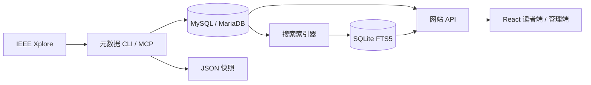

# CIRDC-Pro

[English](README.md) | [简体中文](README_CN.md)

CIRDC-Pro 将 IEEE 科研元数据采集与论文检索网站整合在一个项目中：后端维护期刊、
会议目录、论文基础信息、摘要和分类关键词，网站提供面向读者的检索阅读界面，以及
独立的管理员界面。

元数据后端、网站 API 与前端在**同一个 Git 仓库**中开发；元数据维护包和网站包
使用各自的 Python 环境。

## 项目功能

| 模块 | 能力 |
| --- | --- |
| 元数据后端 | 发现出版物目录、更新基础文献信息、补查摘要与关键词、复查 Early Access、恢复持久任务、原子发布 JSON |
| 论文检索网站 | 检索标题、作者、关键词和摘要，按 DOI／论文编号查找，按年份、出版物与刊会系列筛选，按作者身份浏览 |
| 文献整理 | 查看论文详情，导出 BibTeX、IEEE、GB/T 7714 引用，选择已加载结果并批量导出引用 |
| 管理界面 | 账户管理、任务操作与日志、搜索索引状态、预检，以及可选资源插件的配置 |
| 阅读与显示 | 中英文切换、外观主题、响应式布局、标题数学公式渲染 |
| 可选文献资源 | 显式配置的资源插件可提供缓存正文阅读、本地文献链接及批量打包；实际能力取决于已安装插件及其数据源 |

作者资料库是可选功能，仅在明确指定单个作者时采集；浏览作者身份不会触发资料抓取。
文献正文和文件资源由独立资源能力提供。

## 整体架构与源码



MySQL/MariaDB 保存元数据和持久任务；JSON 保留兼容的 `publicationInfo/`、
`articleInfo/` 目录。网站维护可恢复的 SQLite 搜索投影，论文详情直接读取元数据
数据库。搜索索引进度与元数据维护进度分别记录。

| 路径 | 职责 |
| --- | --- |
| [src/cirdc/](src/cirdc/) | 长期维护的 Python 元数据引擎、CLI 与 stdio MCP |
| [website/src/cirdc/web/](website/src/cirdc/web/) | Starlette/Uvicorn API、认证、账户与搜索索引 |
| [website/web/](website/web/) | React + TypeScript + Vite 前端，使用 KaTeX 渲染公式 |
| [database/](database/) | 空库结构及数据库契约 |
| [tools/](tools/) | 元数据安装／命令行入口，以及网站统一开发命令 |
| [tests/](tests/)／[website/tests/](website/tests/) | 元数据后端与网站 Python 测试 |
| [website/web/tests/](website/web/tests/) | 前端行为测试 |

两套 Python 分发包均名为 `cirdc-pro`，导入名均为 `cirdc`，因此必须**分环境安装**：
元数据维护使用 `.venv`，网站开发使用 `website/.venv-dev`。
网站包保留现有管理功能所依赖的兼容模块，长期采集使用根目录引擎。

## 获取源码

macOS、Linux 需要 Git；使用 SSH 存储时还需要 OpenSSH：

```sh
git clone https://github.com/NicolasV15/CIRDC-Pro.git
cd CIRDC-Pro
```

公开仓库仅包含源码和文档，数据集单独配置，历史采集快照不进入公开源码目录。元数据安装脚本使用 Python 3.12，
必要时可引导安装 uv。网站开发需要 `uv`、Node.js 22.12+ 和 npm，其 Python 环境同样
使用 Python 3.12。维护元数据或构建搜索索引时，需要可用的 MySQL/MariaDB 目标库。

## 元数据后端

### 安装与选择目标

在仓库根目录执行：

```sh
sh tools/setup.sh
sh tools/cirdc --help
```

安装脚本将常规包安装到 `.venv`；拉取或修改后端源码后重新运行以刷新包。
长期采集使用独立固定环境；正在运行的 worker 保留原环境、任务身份与检查点。

使用已有本机数据库和应用账户：

```sh
sh tools/cirdc config-init --output ~/.config/cirdc/targets/local.json
sh tools/cirdc --config ~/.config/cirdc/targets/local.json db-check --json
sh tools/cirdc --config ~/.config/cirdc/targets/local.json target-select --project "$PWD" --json
```

通过自己的 SSH 别名使用已有共享库：

```sh
sh tools/cirdc target-init --ssh YOUR_SSH_ALIAS \
  --remote-config '~/.config/cirdc/config.json' \
  --output ~/.config/cirdc/targets/shared.json --workers 4 --json
sh tools/cirdc --config ~/.config/cirdc/targets/shared.json db-check --json
sh tools/cirdc --config ~/.config/cirdc/targets/shared.json target-select --project "$PWD" --json
```

`target-init` 导入私有配置，不覆盖已有文件。`target-select` 只将配置路径写入被忽略的
`.cirdc/active-target`，供根目录 CLI 和项目 MCP 使用；`--config` 或 `CIRDC_CONFIG`
可显式选择其他配置。模板见 [config.example.json](config.example.json)、
[config.ssh.example.json](config.ssh.example.json)，实际配置保存在 Git 工作区外。

IEEE 请求由启动 worker 的电脑发出。SSH 提供数据库转发和远端 JSON 存储，
不会把抓取移动到存储服务器，也不会更改网络路由。

### 空库示例与严格识别

[database/schema.sql](database/schema.sql) 提供十张表的空结构。
已有 MySQL/MariaDB 服务时，管理员可以创建全新的独立数据库和应用账户：

```sh
.venv/bin/python tools/bootstrap_mysql.py \
  --output ~/.config/cirdc/targets/new-local.json \
  --data-root "$HOME/.local/share/cirdc/collection"
```

也可自行配置空库和账户，填写私有配置后显式初始化：

```sh
sh tools/cirdc --config /path/to/private/profile.json db-check --json
sh tools/cirdc --config /path/to/private/profile.json db-init --json
```

校验覆盖字段、默认值、索引、InnoDB/utf8mb4、迁移记录、应用身份及绑定的数据库 UUID。
兼容目标可直接使用；已识别的旧版 2/3 结构需显式执行 `db-init --adopt`；
不兼容结构或其他应用的数据库会被拒绝。普通更新不会修复任意现存表。
详见[表结构说明](database/README.md)和
[机器可读契约](src/cirdc/schema_contract.json)。

### 更新与恢复

选定并验证目标后：

```sh
sh tools/cirdc doctor --json
sh tools/cirdc plan --publication PUBLICATION_ID --year YEAR --stage enrich --json
sh tools/cirdc update --publication PUBLICATION_ID --year YEAR --stage enrich \
  --skip-import --skip-catalog --workers 4 --json
sh tools/cirdc status RUN_ID --json
sh tools/cirdc resume RUN_ID --workers 4 --json
sh tools/cirdc retry RUN_ID --workers 4 --json
sh tools/cirdc paper ARTICLE_NUMBER --json
```

将大写占位符替换为目标编号和年份。已有 JSON 尚需导入时，省略 `--skip-import`。

| 阶段 | 工作 |
| --- | --- |
| `catalog` | 发现期刊／会议系列并归并出版物目录 |
| `metadata` | 更新论文基础字段，复查指定范围内的 Early Access |
| `enrich` | 读取论文页面，补查摘要和分类关键词 |
| `all` | 组合执行维护阶段 |

全新空集合应先执行 `sh tools/cirdc update --stage catalog --json`，
跟踪该目录任务，再按出版物指定更新范围。默认范围覆盖全部已索引期刊和会议系列；
可用 `--publication`、`--year`、`--max-tasks` 限定范围及预算，
`plan` 只预览计划，不启动 worker。

更新返回持久化任务编号，worker 在启动电脑的后台运行。每个 HTTP 线程使用独立
会话，线程间共用至少一秒的请求启动间隔。协调器负责数据库写入与原子 JSON 发布，
锁、检查点和导出确认支持中断接续。

论文编号作为稳定身份，作者顺序和关键词分类保持不变。来源确认无数据、未来年份
待复查、待办、访问受限和失败分别统计；分页不完整或访问挑战不能当作空结果成功。
字段来源见[维护阶段说明](docs/METADATA_STAGES.md)，任务边界见
[维护生命周期](docs/MAINTENANCE_LIFECYCLE.md)。
引用、参考文献和引用树仅通过 `sh tools/cirdc analyze` 显式调用。

## 网站前端与 API

读者端提供元数据检索、刊会／年份筛选、精确作者身份与论文详情；引用可逐篇或按选择
结果复制、下载。配置资源插件后，可增加正文导航与本地文献文件访问。
读者端与管理端使用各自的路由和会话，管理端仅允许监听本机回环地址。

在仓库根目录安装并构建：

```sh
sh tools/web setup
sh tools/web build
uv pip install --python website/.venv-dev/bin/python \
  --reinstall-package cirdc-pro --no-deps ./website
```

最后一条命令刷新常规开发安装包，使其包含已构建的前端资源。

以 [website/config.example.json](website/config.example.json) 为模板创建私有网站配置，
填写网站主机能够连接的 MySQL 地址，以及该主机可访问的数据路径。
网站使用自己的配置加载器，根目录 CLI 的 SSH 目标选择不会自动配置网站连接。

网站私有状态已初始化时，可启动本机开发读者端：

```sh
export CIRDC_CONFIG=/path/to/private/website.json
export CIRDC_WEB_STATE="$HOME/.local/state/cirdc-web-dev"
sh tools/web serve --interface reader --host 127.0.0.1 --port 18090
```

打开[本机读者页面](http://127.0.0.1:18090/)。全新的状态目录还需初始化账户并构建
搜索索引；索引器单独运行，持续同步元数据变更。
账户初始化、索引、管理员启动、访问模式与部署见[网站指南](website/README_CN.md)。
根目录构建只打包元数据引擎，`sh tools/web build` 生成网站 wheel、源码包及前端资源。

## 开发与验证

| 模块 | 测试 | 构建 |
| --- | --- | --- |
| 元数据后端 | `.venv/bin/python -m pytest` | `.venv/bin/python -m build` |
| 网站 API 与前端 | `sh tools/web test` | `sh tools/web build` |

数据库集成检查使用已验证的独立测试配置：

```sh
CIRDC_INTEGRATION=1 CIRDC_CONFIG=/path/to/private/test-profile.json \
  .venv/bin/python -m pytest
(cd website && CIRDC_INTEGRATION=1 CIRDC_CONFIG=/path/to/private/website-test-profile.json \
  .venv-dev/bin/python -m pytest)
.venv/bin/python tools/check_release.py --component all --private-profile /path/to/private/profile.json
```

两套 Python 测试分别在各自包目录运行。集成测试使用连接内临时表和隔离的锁、路径。
发布检查核对元数据源码及安装包中的部署信息泄漏与空库模板一致性；
网站安装包单独检查。

## Agent 与文档导航

根目录 CLI 和项目 stdio MCP 使用同一元数据引擎与私有目标。
Agent 入口为 [AGENTS.md](AGENTS.md) 和
[cirdc-maintenance Skill](.agents/skills/cirdc-maintenance/SKILL.md)，
[CLAUDE.md](CLAUDE.md) 接入同一流程。
项目 MCP 配置位于 `.mcp.json`、`.codex/config.toml`；
`tools/codex.sh`、`tools/claude.sh` 在项目上下文中启动客户端。

| 文档 | 内容 |
| --- | --- |
| [开发与运行流程](docs/LOCAL_REMOTE_WORKFLOW.md) | 独立环境、固定运行包、存储与部署边界 |
| [维护生命周期](docs/MAINTENANCE_LIFECYCLE.md) | 长期维护与历史修复的职责 |
| [元数据阶段](docs/METADATA_STAGES.md) | 字段来源与 Early Access 行为 |
| [网站指南](website/README_CN.md) | 前端／API 安装、索引、账户和构建 |
| [网站行为与部署](website/docs/web.md) | 检索一致性、访问控制、资源接入及发布回滚 |
| [作者资料库](website/docs/authors.md) | 显式单作者操作与可迁移记录 |

凭据、部署地址、账户状态、索引与检查点保存在 Git 之外，
各机器的运行位置由私有配置维护。

## 公开源码与服务器私有配置

公开源码及两套安装包仅使用通用配置示例。真实主机、地址、SSH 别名、数据路径、
引导账户名单和凭据保留在服务器私有配置中，通过被忽略的机器上下文入口定位；
发布源码不会替换这些配置或重启服务。

发布前构建两套包，再统一检查：
`python tools/check_release.py --component all --private-profile /path/to/private/profile.json --private-values-file /path/to/private/release-values.json`。
私有脱敏文件可以是 JSON 字符串列表，或包含 `values` 列表的对象；
实际节点名和别名放在其中，不进入公开仓库。

## 来源与许可

本项目沿用 Comprehensive IEEE Research Data Collections（CIRDC）。
保留 [CC BY 4.0 许可](LICENSE)与上游署名：Y. Zhang、Y. Li、S. Makonin、R. Kumar，
*Descriptor: Comprehensive IEEE Research Data Collections (CIRDC)*，
IEEE Data Descriptions，vol. 1，pp. 80–86，2024，article 10716731。
